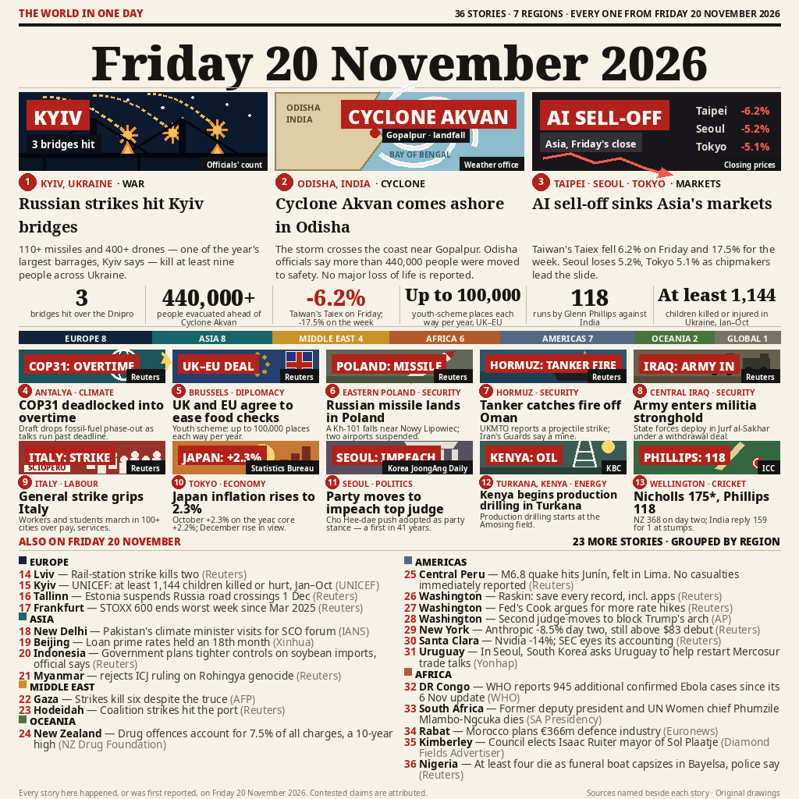

# Friday 20 November 2026 — The World in One Image

[](https://make.fun/bounty/news-image-20261120)

[](https://make.fun/bounty/news-image-20261120)

[](https://make.fun/bounty/news-image-20261120)

One 1024×1024 broadsheet summing up the world news of Friday 20 November
2026 — **36 stories** in all. Three illustrated lead panels lead the page:
Russian strikes hitting Kyiv's bridges, Cyclone Akvan's landfall in
Odisha (with its storm-track map), and the Asian AI sell-off that left
Taiwan's Taiex down 6.2% on the day and 17.5% for the week. Below them sit
a six-number strip, a region tally, and ten numbered feature cards —
COP31's overtime talks in Antalya first, then the UK–EU reset, the
Russian missile downed in Poland, the tanker fire off Oman, Iraq, Italy's
general strike, Japan's CPI, Seoul's impeachment push, Kenya's Turkana
production drilling and Wellington's cricket. The bottom half carries 23
one-line briefs grouped by region — Europe, Asia, the Middle East and
Oceania in the left column, the Americas and Africa in the right — each
with its source named. Every pictured event happened, or was first
reported, on 20 November 2026; contested claims are attributed inside the
image itself — the Kyiv toll to Ukrainian authorities, the tanker fire to
UKMTO's projectile report against Iran's Guards' mine claim. Items that
failed the date check (events of Thursday 19 November, or still to come
on Saturday and Sunday) were excluded and are listed in `STORIES.md`.



## Run it

```sh
# the entrypoint: renders the entry image to the output directory
mkdir -p out && MAKEFUN_OUTPUT_DIR=out node main.ts
```

## How the entry is built

`main.ts` (Node 22, standard library only) produces the entry image by
one of two paths and writes it to `entry.png` in `$MAKEFUN_OUTPUT_DIR`
(default `/output` where that directory exists, else beside `main.ts`):

1. **The true build (canonical).** It copies the bundled generator,
   `generate_v2.py`, into a scratch directory and executes
   `python3 generate_v2.py final` there (Python with Pillow), then
   validates the render — PNG magic bytes and the 1 MiB size limit.
   There is no sha256 gate on this path: Pillow and font versions
   legitimately differ between machines. Where this build was made,
   the render is deterministic — 1024×1024, 291,097 bytes, sha256
   `7d3070dfe9ff532f9e970932f9a440266e747be4b92250e24be64352c2ca50d7`,
   byte-identical to the `entry.png` committed in this repository.
   (`generate_drafts.py`, the v1 generator, remains in the repository
   for provenance; it is no longer the build path.)
2. **The fallback.** The make.fun grading harness runs the entrypoint
   in a node-only image with no python3/Pillow, where the true build
   cannot run. In that case `main.ts` validates the committed
   `entry.png` — which is the generator's verified output from path 1,
   not a substitute render — and emits it unchanged, logging that the
   fallback engaged and why. It exits non-zero only if neither path
   yields a valid image.

See `STORIES.md` for every story, figure and source.

## make.fun

Built for the [news-image-20261120](https://make.fun/bounty/news-image-20261120)
competition on [make.fun](https://make.fun) — "Sum up 20 November's world
news in one image".
